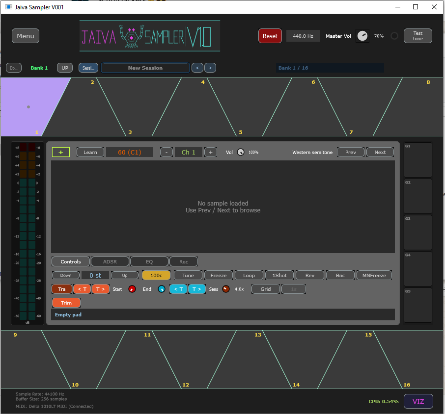
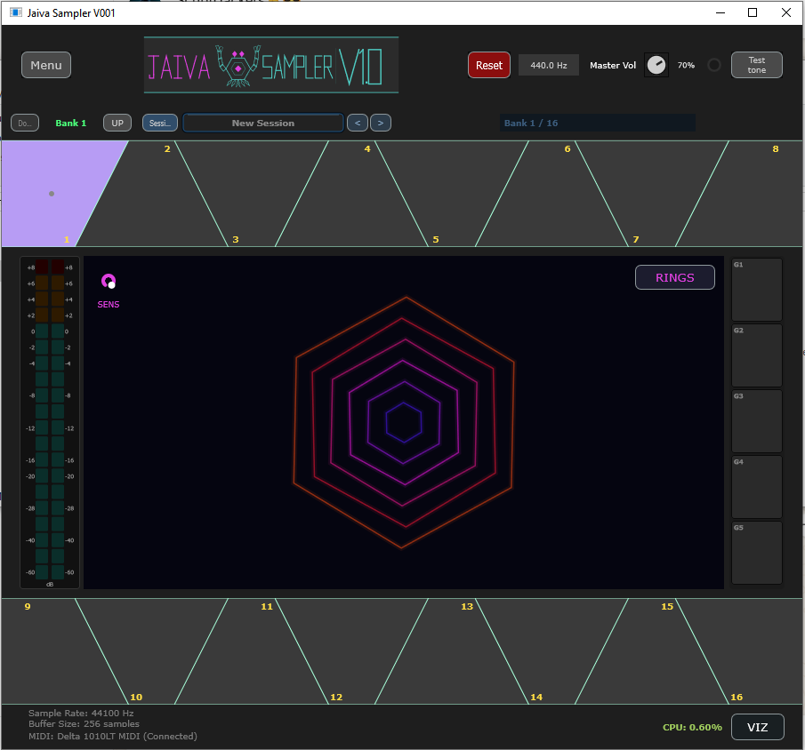

# Jaiba Sampler

A standalone MIDI-triggered audio sampler built with JUCE.

## Jaiba two-board setup

- The drum is two USB-MIDI devices with fixed names, `Jaiba Right` and
  `Jaiba Left`. The app auto-detects both on every launch, retries while one is
  absent, and reopens after a replug — there is no device selection to lose.
- Both streams are merged. MIDI notes are disjoint (right 60–76, left 78–90),
  so sampler pad *i* uses note `60 + 2*i`.
- The last loaded session/kit is restored on startup. The setup autosaves on
  quit and every 30 s while dirty, so pad mappings and MIDI-learned notes
  survive restarts.
- `~/Documents/sounds/jaiva-kits/jaiba-16-map.jai` is an empty kit with all 16
  pads mapped to the right notes — load it once and add samples.
- The MIDI Input dialog is only for an extra/manual controller; the two drum
  boards never need to be selected there.

## Building

This project uses JUCE as a git submodule, so clone with `--recursive`
(or run `git submodule update --init` after a normal clone):

```bash
git clone --recursive https://github.com/vglarra/jaiba-sampler.git
cd jaiba-sampler
cmake -S . -B build -G "Visual Studio 17 2022" -A x64
cmake --build build --config Debug
```

## Screenshots

| Sampler view | Visualizer mode |
|---|---|
|  |  |

## Features
- Audio file loading (WAV/AIFF/MP3)
- MIDI input handling
- Sample playback with looping
- ADSR envelope
- Waveform display
- 16-pad sampler with individual settings
- EQ and filtering
- Normalization
- Trim functionality
- Session persistence

## Usage
1. Launch the application
2. Click the "+" button to load a sample
3. Use the sample card to adjust pitch, volume, start/end points
4. Use the pad grid to switch between different samples
5. Connect a MIDI controller to trigger samples

## Keyboard Shortcuts
- **Escape**: Panic reset (stops all audio)
- **Arrow Keys**: Navigate through samples in folder

## Project Structure
- `src/`: Source code
  - `MainComponent.cpp/h`: Main application component
  - `SampleCard.cpp/h`: Sample editing interface
  - `PadManager.cpp/h`: Manages 16 audio pads
  - `PadAudioEngine.cpp/h`: Audio processing for each pad
- `lib/JUCE/`: JUCE framework
- `assets/`: Sample assets and resources